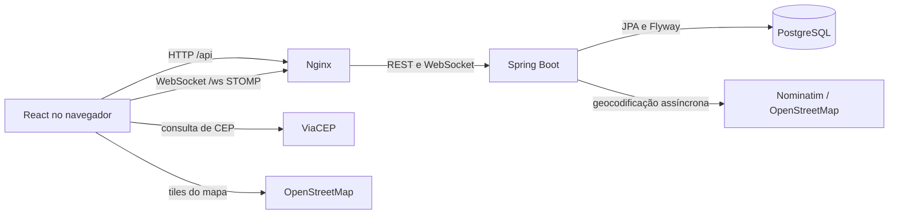

# Foody Delivery

O **Foody Delivery** é uma aplicação web para gerenciar e acompanhar pedidos de delivery, desenvolvida com Java, Spring Boot, React e PostgreSQL.

A solução atende ao núcleo do desafio técnico **Mini Rastreador de Pedidos**: cadastro e autenticação, criação de pedidos com cliente, itens e endereço, consulta de pedidos e atualização de status. O cliente do pedido é independente da conta do operador que o registra.

Além desse fluxo, o projeto inclui recursos complementares de operação e acompanhamento, como notificações em tempo real, geocodificação e mapa, Dashboard, Insights e histórico de status. Essas extensões permitem explorar integrações, rastreabilidade, segurança e resiliência em cenários além do MVP.

## O que foi solicitado e entregue

| Requisito | Como foi atendido |
|---|---|
| **Autenticação**: cadastro e login com nome, e-mail e senha; acesso autenticado | Cadastro e login com validação e senha armazenada com BCrypt. As áreas de pedidos exigem autenticação. |
| **Backend**: API REST em Java e Spring Boot | API implementada em Java 21 e Spring Boot para autenticação, pedidos e consultas complementares. |
| **Pedidos**: criar pedido, listar, consultar por ID e atualizar entre cinco status | Criação com dados do cliente, itens e endereço; consulta por ID; transições controladas entre os estados definidos. A listagem retorna os pedidos do operador autenticado. O enunciado diz “listar todos os pedidos”; esta implementação não oferece uma listagem global entre operadores. |
| **Persistência**: banco de dados relacional ou tecnologia similar | PostgreSQL com JPA e migrations Flyway. |
| **Frontend**: aplicação React para listar pedidos, exibir status e criar pedidos | Interface React com páginas de pedidos, criação, detalhes e acompanhamento do status. |
| **Versionamento**: repositório Git com histórico de commits | Implementação mantida em repositório Git com histórico versionado. |

### Operador e cliente do pedido

O **operador** é o usuário autenticado responsável por registrar e acompanhar os pedidos. O **cliente** é quem receberá o pedido e não precisa ter uma conta na aplicação. A migration `V8__separate_order_customer_from_owner.sql` formaliza essa separação entre `owner_id` e os campos do cliente (`customer_name`, `customer_phone` e `customer_email`). Consultas e alterações ficam limitadas ao operador proprietário; pedidos criados antes da V8 podem não ter dados de cliente.

## Além do desafio: funcionalidades complementares

As extensões abaixo não eram requisitos do desafio. O fluxo central pode ser atendido por um MVP mais enxuto; esses recursos acrescentam cenários de operação, integração e qualidade, junto dos custos e limites descritos em [Decisões técnicas e trade-offs](#decisões-técnicas-e-trade-offs).

### Atualizações em tempo real

Quando um operador altera o status, a mudança é persistida no PostgreSQL e, após o commit, o backend publica um evento STOMP por WebSocket para o operador responsável. O frontend recebe a notificação e atualiza os dados exibidos sem polling contínuo. A API REST e o histórico persistido continuam como fonte de verdade; o broker em memória torna as notificações best effort.

### Geocodificação e mapas

No formulário, o ViaCEP pode preencher dados postais a partir do CEP. Depois que o pedido é salvo, uma tarefa assíncrona consulta o Nominatim, usando dados do OpenStreetMap, para sugerir coordenadas. A busca tenta variações do endereço; o operador confirma a localização no mapa Leaflet ou seleciona outro ponto. Isso reduz digitação e ajuda a revisar o local de entrega sem confundir uma sugestão aproximada com uma confirmação. Os serviços são externos e tarefas pendentes ficam em memória.

### Dashboard operacional

O Dashboard resume pedidos criados, distribuição por status, entregas e cancelamentos, atividade diária e pedidos recentes ou em andamento. O operador escolhe um período de até 366 dias, interpretado no fuso `America/Sao_Paulo`. Os indicadores oferecem uma visão operacional rápida e respeitam o isolamento por operador.

### Insights comerciais

Insights compara períodos de mesma duração e agrupa atividade por dia e hora, produtos e tempos calculados a partir do histórico. Essas consultas permitem explorar horários mais ativos, itens frequentes e tempos da operação. Os valores exibidos são os registrados nos pedidos; não representam pagamentos recebidos, faturamento confirmado ou lucro.

### Histórico de pedidos

O estado inicial e cada transição aprovada são gravados no banco com estado anterior e novo, horário e operador, na mesma transação que atualiza o pedido. A linha do tempo permite reconstruir a sequência de eventos e identificar quem realizou cada mudança, em vez de depender apenas do status atual.

### Busca e paginação

Na listagem, é possível buscar parcialmente por nome ou e-mail, por telefone ou por UUID, filtrar por status e percorrer páginas de até 50 resultados. Esses critérios ajudam a localizar um pedido em listas maiores; todos os resultados continuam limitados ao operador autenticado.

### Segurança e integridade

Spring Security e JWT protegem as rotas, e consultas de pedidos são escopadas ao operador autenticado. As regras de domínio validam as transições de status; o controle otimista com `@Version` detecta atualizações concorrentes. Assim, acessos cruzados, mudanças inválidas e sobrescritas silenciosas são rejeitados; um conflito retorna `409 Conflict` e exige consultar novamente o pedido.

### Resiliência e observabilidade

Para a geocodificação, chamadas ao Nominatim têm timeout e limite local de uma por segundo. Falhas transitórias podem ser repetidas com backoff e jitter, respeitando `Retry-After`; o circuit breaker interrompe chamadas quando há falhas recorrentes. Isso reduz pressão sobre o provedor e não afeta pedidos já gravados. A API também oferece respostas estruturadas, `X-Correlation-ID`, Actuator e logs JSON em produção. O retry ocupa o único worker assíncrono enquanto espera; métricas e limitadores não são compartilhados entre instâncias, e não há serviço externo configurado para dashboards ou alertas.

### Qualidade e execução

JUnit e Testcontainers exercitam o backend com PostgreSQL; Vitest e Testing Library cobrem o frontend. JaCoCo gera relatórios de cobertura e SpotBugs analisa o backend. Docker Compose reúne banco, API e interface, enquanto Nginx serve a SPA e encaminha `/api` e `/ws`. Isso simplifica a execução integrada e a verificação dos fluxos; os testes de integração precisam de Docker e não há meta mínima de cobertura.

## Abordagem de engenharia e qualidade

No **backend**, Java 21 e Spring Boot organizam a API REST e as regras do domínio. Spring Data JPA e PostgreSQL cuidam da persistência relacional, e Flyway versiona a evolução do schema. Essa separação conecta os fluxos de pedidos a dados persistidos e consultáveis.

No **frontend**, React com TypeScript estrutura páginas e componentes; Material UI fornece os componentes visuais, Vite cuida do desenvolvimento e build, e TanStack Query gerencia consultas e atualização de dados. A interface conversa com o backend por REST e também recebe eventos STOMP. ViaCEP, Nominatim, OpenStreetMap e Leaflet compõem os fluxos de endereço e localização descritos acima.

A qualidade é apoiada por testes unitários e de integração com JUnit e Testcontainers, testes de interface com Vitest e Testing Library, análise estática com SpotBugs, relatórios JaCoCo e lint do frontend. Docker Compose e Nginx oferecem uma execução integrada. Os comandos e resultados registrados estão em [Testes e validação](#testes-e-validação); as limitações e trade-offs de sessão, mecanismos em memória e serviços externos estão detalhados adiante.

O Codex foi utilizado como ferramenta de apoio ao desenvolvimento e à revisão. As sugestões foram avaliadas em relação ao código e aos resultados de validação; decisões técnicas e aprovação do conteúdo permaneceram sob responsabilidade do desenvolvedor.

## Arquitetura



No fluxo principal, o navegador envia um pedido pela API REST; o backend valida os dados, calcula o total e persiste no PostgreSQL. Geocodificação é iniciada após a gravação. Eventos de status são publicados após o commit. ViaCEP e os tiles do mapa são acessados pelo navegador.

### Tecnologias

- **Backend:** Java 21, Spring Boot, Spring MVC, Spring Security, OAuth2 Resource Server, Spring Data JPA, Bean Validation e Springdoc OpenAPI.
- **Banco e schema:** PostgreSQL 17 e Flyway, com migrations `V1` a `V8`.
- **Frontend:** React, TypeScript, Vite, React Router, TanStack Query, Axios, React Hook Form e Zod.
- **Interface e mapas:** Material UI, Leaflet e React Leaflet.
- **Comunicação e resiliência:** STOMP, Bucket4j e Resilience4j.
- **Testes e análise:** JUnit 5, Testcontainers, Vitest, Testing Library, JaCoCo e SpotBugs.
- **Execução:** Docker Compose e Nginx.

## Como executar

### Requisitos

- Docker e Docker Compose.
- OpenSSL para gerar o segredo JWT local.

### Aplicação integrada

Na raiz do repositório:

```bash
cp .env.example .env
openssl rand -base64 32
```

Copie o valor gerado para `JWT_SECRET` em `.env`. Esse arquivo é ignorado pelo Git; não versione segredos reais. Em publicação HTTPS, configure `AUTH_COOKIE_SECURE=true`, as origens permitidas e os valores adequados para os serviços externos.

Inicie os serviços:

```bash
docker compose up --build -d
```

- Aplicação: [http://localhost:3000](http://localhost:3000)
- Swagger: [http://localhost:8080/swagger-ui/index.html](http://localhost:8080/swagger-ui/index.html)
- Health do frontend: [http://localhost:3000/health](http://localhost:3000/health)

As portas podem ser alteradas por `FRONTEND_PORT`, `BACKEND_PORT` e `POSTGRES_PORT` no `.env`. Para parar os serviços mantendo o volume do banco:

```bash
docker compose down
```

Não use `-v` se quiser preservar os dados do PostgreSQL.

### Frontend em desenvolvimento

Com o backend disponível em `http://localhost:8080`, no diretório `frontend/`:

```bash
npm ci
npm run dev
```

O Vite encaminha `/api` e `/ws` ao backend local. `VITE_API_BASE_URL` é vazio por padrão; `VITE_DEMO_MODE=true` usa dados simulados de login, pedidos, Dashboard e Insights, sem autenticação ou persistência reais.

## Como utilizar

1. Cadastre-se em `/register` com nome, e-mail e senha e entre em `/login`.
2. Em **Novo pedido**, informe cliente, itens e endereço. O CEP pode preencher parte do endereço via ViaCEP.
3. Em `/orders`, consulte seus pedidos, filtre por status ou busque por cliente, telefone, e-mail ou ID.
4. Abra um pedido para ver seus detalhes, histórico e localização, quando disponível.
5. Use as ações disponíveis para avançar o status. O backend valida cada transição; após conflito, consulte o pedido novamente.
6. Dashboard e Insights apresentam agregados complementares. Valores de pedidos não significam pagamentos confirmados.

## API e regras de negócio

As rotas de pedidos e Insights requerem `Authorization: Bearer <accessToken>`. No Swagger, faça login e informe o `accessToken` em **Authorize**. O cookie de sessão é usado para renovar o token.

| Método e rota | Acesso | Descrição |
|---|---|---|
| `POST /api/auth/register` | Público | Cadastra usuário. |
| `POST /api/auth/login` | Público | Autentica e cria sessão persistente. |
| `POST /api/auth/refresh` | Cookie de sessão | Renova o access token. |
| `POST /api/auth/logout` | Cookie de sessão | Revoga a sessão; JWTs já emitidos permanecem válidos até expirar. |
| `GET /api/users/me` | Autenticado | Retorna o usuário atual. |
| `POST /api/orders` | Autenticado | Cria pedido no estado inicial `RECEBIDO`. |
| `GET /api/orders?page=0&size=10&status=RECEBIDO&search=Maria` | Autenticado | Lista pedidos próprios, mais recentes primeiro; filtros opcionais, tamanho máximo 50. |
| `GET /api/orders/{id}` | Autenticado | Consulta pedido próprio. Pedidos de outro operador retornam `404`. |
| `PATCH /api/orders/{id}/status` | Autenticado | Atualiza status conforme a máquina de estados. |
| `GET /api/orders/{id}/history` | Autenticado | Consulta histórico cronológico. |
| `GET /api/orders/dashboard?from=AAAA-MM-DD&to=AAAA-MM-DD` | Autenticado | Consulta indicadores operacionais. |
| `GET /api/insights?from=AAAA-MM-DD&to=AAAA-MM-DD` | Autenticado | Consulta agregados e comparativo de períodos. |
| `POST /api/orders/{id}/geocode` | Autenticado | Agenda geocodificação; retorna `202 Accepted`. |
| `PATCH /api/orders/{id}/location` | Autenticado | Confirma coordenadas escolhidas manualmente. |

### Exemplo de criação de pedido

`customer` é obrigatório; e-mail do cliente é opcional. O telefone deve conter DDD e 8 ou 9 dígitos locais; pontuação é removida na validação. Quantidade e preço unitário devem ser positivos. O backend calcula o total com `BigDecimal`.

```json
{
  "customer": {
    "name": "Maria Silva",
    "phone": "11999999999",
    "email": "maria@example.com"
  },
  "items": [
    { "productName": "Hambúrguer Artesanal", "quantity": 2, "unitPrice": 32.90 },
    { "productName": "Refrigerante", "quantity": 1, "unitPrice": 8.50 }
  ],
  "deliveryAddress": {
    "street": "Rua das Flores",
    "number": "120",
    "complement": "Apto 42",
    "neighborhood": "Centro",
    "city": "São Paulo",
    "state": "SP",
    "postalCode": "01001000"
  }
}
```

### Máquina de estados

| Estado atual | Próximos estados permitidos |
|---|---|
| `RECEBIDO` | `EM_PREPARO`, `CANCELADO` |
| `EM_PREPARO` | `SAIU_PARA_ENTREGA`, `CANCELADO` |
| `SAIU_PARA_ENTREGA` | `ENTREGUE` |
| `ENTREGUE` | Nenhum; terminal |
| `CANCELADO` | Nenhum; terminal |

Transição inválida ou conflito concorrente retorna `409`; dados inválidos retornam `400`. No escopo atual, o proprietário pode atualizar o status. Uma operação com perfis distintos de restaurante e logística pode exigir autorização por papel.

## Testes e validação

### Comandos

No diretório `backend/` (Docker é necessário para testes de integração com Testcontainers):

```bash
./mvnw clean verify
```

No diretório `frontend/`:

```bash
npm ci
npm run test:run
npm run lint
npm run build
```

O Maven executa JaCoCo e SpotBugs durante `verify`. JaCoCo gera relatório, sem limite mínimo de cobertura configurado.

### Registro da validação técnica

Na validação executada em **19/10/2026**, no `HEAD` `a028d16`, foram registrados: backend com 69 testes aprovados; frontend com 73 testes aprovados; lint e build de produção aprovados; SpotBugs sem achados; Docker Compose com os serviços saudáveis; e smoke tests do fluxo obrigatório aprovados. O diretório local `backend/target` ainda contém relatórios Surefire de 19/10/2026 com 69 testes e zero falhas, relatório JaCoCo e saída SpotBugs sem instâncias de bugs.

Esses resultados pertencem à validação técnica daquele `HEAD`; não foram reexecutados durante esta revisão editorial. A revisão confirma que o `HEAD` permanece em `a028d16` e que a alteração local se limita ao README. O arquivo [docs/VALIDACAO_FINAL.md](docs/VALIDACAO_FINAL.md) é um registro mais antigo, de outro estado e com contagens diferentes; não é a fonte dos resultados acima.

## Decisões técnicas e trade-offs

- **Escopo da listagem:** cada operador vê apenas seus pedidos. Isso protege o isolamento dos dados, mas diverge da leitura literal de “listar todos os pedidos” como lista global.
- **Sessão persistente:** o access token JWT tem expiração configurável e fica em memória no frontend; o refresh token é armazenado pelo navegador em cookie `HttpOnly`, `SameSite=Strict`, com `Max-Age` de 400 dias, e no banco fica apenas seu hash. O refresh não é rotacionado e o banco não impõe expiração do registro. Logout revoga o refresh, mas um access token já emitido continua válido até expirar.
- **Estado em memória:** broker STOMP, rate limits, circuit breaker, limiter Nominatim e fila/controle de geocodificação são locais à instância. Reinício pode perder tarefas pendentes e múltiplas instâncias não compartilham esses estados.
- **Proxy e rate limiting:** o limite por IP usa o endereço remoto da conexão e não lê `X-Forwarded-For`. Atrás do Nginx, vários clientes podem compartilhar o limite do endereço do proxy.
- **Serviços externos:** ViaCEP, Nominatim e tiles do OpenStreetMap dependem de disponibilidade e políticas externas. A falha de geocodificação não desfaz o pedido; a localização pode ser confirmada manualmente. Consulte a [política de uso do Nominatim](https://operations.osmfoundation.org/policies/nominatim/).
- **Dados analíticos:** Dashboard e Insights agregam pedidos e eventos registrados, não pagamentos, estoque ou lucro.
- **MVP:** um fluxo mínimo com autenticação, pedidos, status e persistência poderia atender ao núcleo do enunciado. Extensões como geocodificação, STOMP e analytics ampliam manutenção e superfície operacional.

## Limitações de escopo

Não fazem parte da implementação: pagamentos, catálogo de produtos, gestão de estoque, cálculo de frete, otimização de rotas e rastreamento GPS em tempo real.

## Demonstração e documentação complementar

Não há screenshots ou vídeo de demonstração incluídos neste repositório.

- [Guia do frontend](frontend/README.md)
- [Guia do backend](backend/README.md)
- [Registro técnico anterior](docs/VALIDACAO_FINAL.md) — histórico de uma validação em outro estado do repositório, com resultados distintos dos registrados acima.
